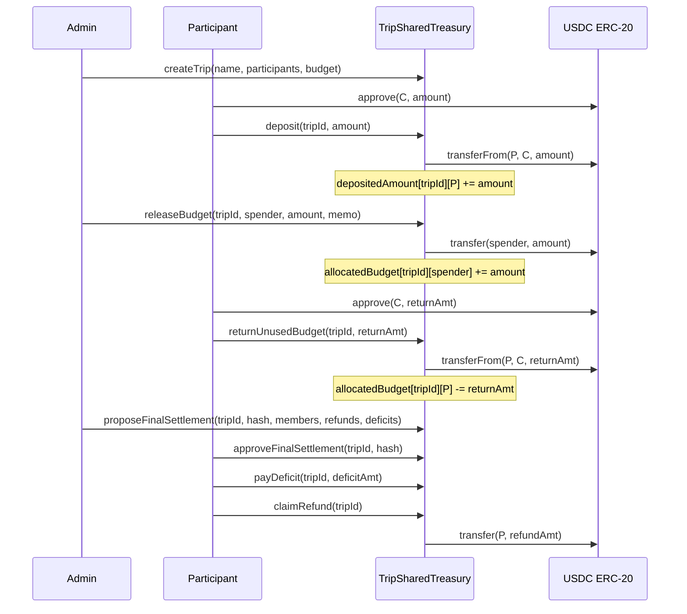

# TripSharedTreasury — Smart Contract Design Document

**Status:** Draft  
**Authors:** Arc Studio  
**Target Chain:** Arc Testnet (Chain ID 2)  
**Language/Toolchain:** Solidity 0.8.28, Foundry/Forge  
**EVM Hardfork:** Paris  
**Date:** 2026-10-16  

**Review Tracker:**
- [ ] Design Review
- [ ] Security Review
- [ ] Ops Review

---

## Action Items (living)

_Starts empty — fill after each review round._

---

## 1. Goals / Non-Goals

### Goals
- 여행 참여자들이 공동 지갑(컨트랙트)에 USDC를 입금하고, 예산을 결제자에게 이체하며, 지출을 기록·분담·정산하는 전 과정을 온체인에서 투명하게 관리한다.
- 개인별 정산 차액(실제 납입액 - 최종 부담액 - 미반납 결제예산)을 항상 일관성 있게 계산한다.
- 최종 정산은 참여자 전원 승인 + 부족분 납입 완료 + 컨트랙트 잔액 일치 세 조건이 모두 충족될 때만 환급을 허용한다.
- 관리자도 공동자금을 단독으로 임의 인출할 수 없다.

### Non-Goals
- 지출 영수증 진위 검증 (오프체인 데이터, 컨트랙트 외부)
- 환율 자동 환산 (프론트엔드가 USDC 기준금액으로 변환해 입력)
- 크로스체인 이체
- 업그레이드 가능한 프록시 구조 (고정 배포)

---

## 2. Requirements

### Functional
- `createTrip`: 여행방 생성, 참여자 목록 등록, 목표 예산 설정
- `deposit`: 실제 USDC ERC-20 전송으로만 납입 완료 인정 (예정액과 완료액 분리 추적)
- `releaseBudget`: 관리자가 결제자 외부 지갑으로 공동자금 이체 (여행 지출 아님, `allocatedBudget` 누적)
- `returnUnusedBudget`: 결제자가 남은 공동자금을 컨트랙트로 반납
- `payDeficit`: 부족분 납부자가 추가 입금
- `proposeFinalSettlement`: 관리자가 최종 정산안(`ledgerHash` + 환급/부족 배열) 등록
- `approveFinalSettlement`: 각 참여자가 동일 `ledgerHash` 승인
- `claimRefund`: 전원 승인 + 부족분 완납 + 잔액 일치 시 환급

### Security
- 임의 인출 불가: 관리자 포함 누구도 `claimRefund` 절차 외로 컨트랙트 잔액을 꺼낼 수 없다
- `depositedAmount[tripId][user]` 는 실제 `transferFrom` 성공 후에만 증가
- `allocatedBudget[tripId][spender]` 와 컨트랙트 잔액은 이중 합산되지 않는다
- `claimRefund` 는 1회만 허용 (`refundClaimed` 플래그)
- 최종 정산 승인은 `ledgerHash` 가 일치할 때만 유효
- 새 정산안 제출 시 기존 승인 전원 초기화

---

## 3. Terminology & Actors

| Term | Definition |
|---|---|
| Trip | 여행방. 하나의 `tripId`로 식별되는 공동경비 공간 |
| Admin | 여행방 생성자. 예산 이체, 정산안 제출 가능 |
| Participant | 여행방 참여자. 입금, 정산 승인, 환급 수령 가능 |
| depositedAmount | 실제 USDC 전송으로 확인된 납입 완료액 |
| allocatedBudget | 결제자 외부 지갑으로 이체된 공동자금 (미반납분) |
| ledgerHash | 최종 정산안의 bytes32 해시 (참여자별 금액 배열의 오프체인 해시) |
| refundAmount | 정산안에서 각 참여자에게 돌려줄 금액 |
| deficit | 정산안에서 각 참여자가 추가로 납부해야 할 금액 |

| Actor | On/Off-chain | Trust Level | Capabilities |
|---|---|---|---|
| Admin | On-chain | Semi-trusted | `createTrip`, `releaseBudget`, `proposeFinalSettlement` |
| Participant | On-chain | Semi-trusted | `deposit`, `returnUnusedBudget`, `payDeficit`, `approveFinalSettlement`, `claimRefund` |
| USDC Contract | On-chain | Trusted | ERC-20 토큰 이전 |

---

## 4. Language / Runtime

- Solidity 0.8.28 (자동 오버플로우 보호, 커스텀 에러)
- Forge 빌드, Foundry 테스트
- EVM 하드포크: Paris (`evm_version = "paris"`, `mcopy` 없음)
- OpenZeppelin 5.1.0 (`SafeERC20`, `ReentrancyGuard`)

---

## 5. Transaction & Execution Model

- 모든 상태 변경은 원자적 (성공 또는 전체 롤백)
- 외부 호출: USDC ERC-20 `transferFrom` / `transfer`
- CEI(Checks-Effects-Interactions) 패턴 적용: 상태 변경 후 외부 호출
- `nonReentrant` 수정자: `deposit`, `releaseBudget`, `returnUnusedBudget`, `payDeficit`, `claimRefund`에 적용

---

## 6. Architecture Overview



### Flow of Funds

| Step | Who Moves What | Invariant |
|---|---|---|
| deposit | Participant → Contract | `sum(depositedAmount) == contractBalance + sum(allocatedBudget)` |
| releaseBudget | Contract → Spender | `allocatedBudget[spender] += amount`; contract balance decreases |
| returnUnusedBudget | Spender → Contract | `allocatedBudget[spender] -= amount`; contract balance increases |
| payDeficit | Participant → Contract | `paidDeficit[tripId][user] += amount` |
| claimRefund | Contract → Participant | 한 번만 수령; `refundClaimed[tripId][user] = true` |
| **Resting state** | — | 정산 전: 컨트랙트가 자금 보관; 정산 완료: 잔액 0 |

---

## 7. Contract Design

### Roles

| Role | Holder | Permissions |
|---|---|---|
| Admin | Trip creator | `releaseBudget`, `proposeFinalSettlement` |
| Participant | Registered on `createTrip` | `deposit`, `returnUnusedBudget`, `payDeficit`, `approveFinalSettlement`, `claimRefund` |

### Key State Variables

```solidity
struct Trip {
    string name;
    address admin;
    address[] participants;
    uint256 targetBudget;
    bool exists;
    // Settlement state
    bytes32 pendingSettlementHash;
    address[] settlementMembers;
    uint256[] finalRefundAmounts;
    uint256[] requiredDeficits;
    bool settlementProposed;
}

mapping(uint256 => Trip) public trips;
mapping(uint256 => mapping(address => uint256)) public depositedAmount;
mapping(uint256 => mapping(address => uint256)) public allocatedBudget;
mapping(uint256 => mapping(address => bool)) public settlementApproved;
mapping(uint256 => mapping(address => uint256)) public paidDeficit;
mapping(uint256 => mapping(address => bool)) public refundClaimed;
mapping(uint256 => mapping(address => bool)) public isParticipant;
uint256 public tripCount;
IERC20 public immutable usdc;
```

### Functions (Write)

| Function | Caller | State Mutated | Events | Revert Conditions |
|---|---|---|---|---|
| `createTrip` | Anyone | `trips[id]`, `isParticipant` | `TripCreated` | Empty participants, duplicate |
| `deposit` | Participant | `depositedAmount` | `Deposited` | Not participant, amount 0, transferFrom fail |
| `releaseBudget` | Admin | `allocatedBudget` | `BudgetReleased` | Not admin, insufficient contract balance |
| `returnUnusedBudget` | Participant | `allocatedBudget` | `BudgetReturned` | Exceeds allocated, transferFrom fail |
| `payDeficit` | Participant | `paidDeficit` | `DeficitPaid` | Exceeds required deficit |
| `proposeFinalSettlement` | Admin | `pendingSettlementHash`, resets `settlementApproved` | `SettlementProposed` | Pending settlement exists with unapproved, array length mismatch |
| `approveFinalSettlement` | Participant | `settlementApproved` | `SettlementApproved` | Hash mismatch, not participant |
| `claimRefund` | Participant | `refundClaimed` | `RefundClaimed` | Not all approved, deficit unpaid, balance mismatch, already claimed |

---

## 8. Security Considerations

| Vulnerability | Applicable? | Mitigation |
|---|---|---|
| Reentrancy | Yes | CEI ordering + `nonReentrant` on all fund-moving functions |
| Access control | Yes | `onlyAdmin(tripId)`, `onlyParticipant(tripId)` modifiers |
| Integer overflow/underflow | Solidity ≥0.8 checked | No `unchecked` blocks on fund arithmetic |
| Unchecked external call / return | Yes | `SafeERC20.safeTransfer` / `safeTransferFrom` |
| Fee-on-transfer / rebasing tokens | No | USDC is fixed-supply; explicit amount tracking |
| Signature replay | No | No off-chain signatures used |
| Front-running / MEV | Low | Final settlement requires all participants' on-chain approval |
| Flash-loan / price manipulation | No | No price oracle |
| Denial of service | Yes | Pull-over-push for refunds; bounded participant arrays |
| Delegatecall / proxy safety | No | Not upgradeable |
| Timestamp / block dependence | No | Not used for critical logic |
| Approval persistence | Yes | SafeERC20; no dangling max-approvals in contract |
| Centralization risk | Yes | Admin cannot unilaterally withdraw; requires all participant consent |
| Double-counting balances | Yes | `allocatedBudget` tracked separately; `contractBalance != depositedAmount` |

---

## 9. Trust Model & Threat Analysis

| Actor | Worst-case if compromised | Mitigation |
|---|---|---|
| Admin key | Can release budget to arbitrary address, propose false settlement | All participants must approve settlement; refund requires full consent |
| Participant key | Can approve false settlement | Requires ALL other participants too; hash must match |
| USDC contract | Token transfer manipulation | Using official Arc USDC at `0x3600000000000000000000000000000000000000` |

---

## 10. Deployment & Initialization

- Constructor args: `address usdcToken` (Arc USDC: `0x3600000000000000000000000000000000000000`)
- No proxy; single deploy
- No `initialize` function needed

---

## 11. Upgradeability

Not upgradeable. Fixed deployment. Migration path: new contract deployment with manual data migration via events/indexer.

---

## 12. Testing Strategy

- Unit tests: Foundry `.t.sol` — happy path, revert paths, access control, fuzz key arithmetic
- Invariant: `sum(depositedAmount) + sum(paidDeficit) == contractBalance + sum(allocatedBudget) + sum(claimedRefunds)`
- Static analysis: Slither
- Integration: post-deploy against Arc Testnet

---

## 13. Third-party Libraries

| Library | Version | Already dep? | Why | Security reviewed? |
|---|---|---|---|---|
| OpenZeppelin Contracts | 5.1.0 | Yes | `SafeERC20`, `ReentrancyGuard` | Yes (industry standard) |
